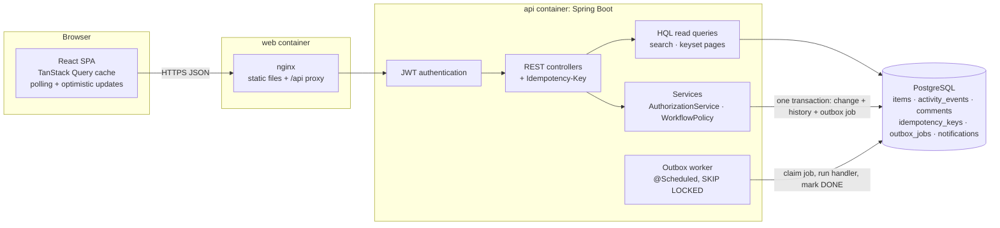
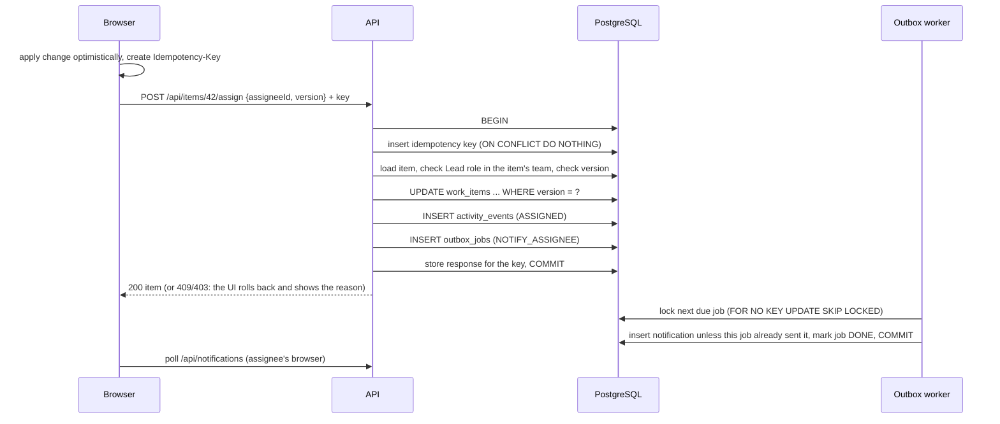

# Newtonite Ops

An internal web application that replaces chat threads and spreadsheets for operational work.
Teams create **work items** (incidents, customer issues, payments, compliance requests, tasks),
take ownership, move them through a server-enforced workflow with Lead approval where needed,
and see a complete history of who changed what and why. It is built to behave correctly when
many people act on the same item at once.

**Stack:** Java 21 · Spring Boot 3.5 · PostgreSQL 16 · Flyway · React 19 (JavaScript) · TanStack Query · Vite · Docker Compose

| Document | Contents |
|----------|----------|
| [ENGINEERING_DECISIONS.md](ENGINEERING_DECISIONS.md) | The key decisions, the alternatives considered and the trade-offs |
| [docs/DESIGN.md](docs/DESIGN.md) | Data model, permission matrix, workflow, REST API, status codes |
| [docs/ASSUMPTIONS.md](docs/ASSUMPTIONS.md) | Every open product question and the assumption made |

---

## Quick start

Prerequisite: **Docker Desktop** (or Docker Engine with Compose v2). Nothing else is needed to run the app.

```bash
docker compose up --build
```

The first build downloads Maven and npm dependencies and takes a few minutes. Then open:

| What | URL |
|------|-----|
| **Web app** | http://localhost:3000 |
| REST API | http://localhost:8081/api (Swagger UI: http://localhost:8081/api/docs) |
| PostgreSQL | `localhost:5433`, database/user/password `newtonite` |

On first start Flyway creates the schema and loads demo data: 4 teams, 11 users and about 5,000
work items with history. If a port is taken, copy `.env.example` to `.env` and change
`WEB_PORT`, `API_PORT` or `DB_PORT`. To start again from an empty database, run
`docker compose down -v`.

### Demo users

All passwords are **`demo1234`**. The login page has one-click buttons for the main accounts.

| User | Teams and roles |
|------|-----------------|
| alice@newtonite.test | Payments **Lead**, Compliance Member |
| bob@newtonite.test | Payments Member |
| judy@newtonite.test | Payments Member |
| carol@newtonite.test | Platform Engineering **Lead** |
| dave@newtonite.test | Platform Engineering Member, Payments **Viewer** |
| frank@newtonite.test | Platform Engineering Member, Customer Support Member |
| ivan@newtonite.test | Platform Engineering **Viewer** |
| erin@newtonite.test | Customer Support **Lead** |
| heidi@newtonite.test | Customer Support Member, Compliance Member |
| grace@newtonite.test | Compliance **Lead** |
| admin@newtonite.test | Global admin (acts as Lead in every team) |

### Things to try

1. **Approval workflow.** As **bob**, open *Refund 12,400 INR to merchant M-2231*: it is awaiting
   approval and bob cannot approve it. As **alice** (Payments Lead), approve it, or reject it
   with a reason. Bob gets a notification a moment later, delivered by the background worker.
2. **Claim race.** Open the same unassigned item as **bob** and **judy** in two browsers (one in a
   private window) and press *Claim* in both. One wins; the other sees "Already assigned to ...".
3. **Stale edit.** Open *Edit* on an item as **alice**, change the same item in another window,
   then save the first one. The save is refused, the latest version is shown and your draft is
   kept; saving again applies only the fields you changed.
4. **Authorization.** As **dave**, open a Payments item: he can read it but has no actions. As
   **carol**, open the same URL: "Not found", because she is not in Payments.
5. **Scale.** On *Work items*, search ("refund", or `#5001`), combine filters, and use *Load more*:
   every filter and page is computed by the database.

---

## Architecture



What happens when a Lead assigns an item:



### Critical behaviours beyond CRUD

| Situation | How it is handled | Proven by |
|-----------|-------------------|-----------|
| Two users claim the same item | Conditional `UPDATE ... WHERE assignee_id IS NULL`; losers get `409 ALREADY_CLAIMED` | `ConcurrencyTest` |
| Editing stale information | `version` checked on every change plus JPA `@Version`; `409 STALE_VERSION` returns the current item | `ConcurrencyTest`, browser flow |
| Repeated requests (double click, retry) | `Idempotency-Key` stored in the action's transaction; replayed response | `IdempotencyTest`, `hooks.test.jsx` |
| Workflow rules | Allowed transitions and who may perform them in `WorkflowPolicy`; approval only by a Lead of the item's team | `WorkflowTest` |
| Resource-level authorization | Role in the item's team checked on every request; outsiders get 404 | `AuthorizationTest` |
| Reliable asynchronous work | Transactional outbox, `SKIP LOCKED`, backoff, `FAILED` after max attempts, idempotent handlers | `OutboxWorkerTest` |
| Optimistic UI vs server decisions | Immediate update, rollback on rejection, server copy on conflict | `hooks.test.jsx` |
| History never disagrees with the item | Activity event written in the same transaction as the change | `HistoryAndListTest` |

---

## Tests

**Backend** (needs JDK 21+ and a running Docker; Testcontainers starts its own PostgreSQL):

```bash
cd backend
./mvnw test
```

On Windows Command Prompt or PowerShell use `mvnw.cmd test`. The 36 tests call the real HTTP API
of a running server backed by real PostgreSQL. Row locks, conditional updates and `ON CONFLICT`
cannot be verified against mocks or an in-memory database. Several tests fire 8–10 requests at the
same instant to prove only one wins.

**Frontend** (needs Node.js 20.19+):

```bash
cd frontend
npm install
npm test
```

These cover optimistic update rollback, replacing the cache with the server copy on a version
conflict, and retries reusing the same idempotency key.

---

## Local development

```bash
docker compose up -d db                     # PostgreSQL only
cd backend && ./mvnw spring-boot:run        # API on :8081, worker included
cd frontend && npm install && npm run dev   # UI on :5173, /api proxied to :8081
```

| Variable | Default | Purpose |
|----------|---------|---------|
| `DB_URL`, `DB_USER`, `DB_PASSWORD` | `jdbc:postgresql://localhost:5433/newtonite`, `newtonite`, `newtonite` | Database |
| `APP_JWT_SECRET` | dev-only value | HS256 signing key, at least 32 characters. **Override outside local demos.** |
| `APP_JWT_TTL` | `8h` | Token lifetime |
| `OUTBOX_ENABLED` | `true` | Run the outbox worker in this instance |
| `FLYWAY_LOCATIONS` | migrations + demo seed | Set to `classpath:db/migration` for an empty database |

### Project layout

```
backend/   Spring Boot API
  src/main/java/com/newtonite/ops/
    auth/          login, JWT, security configuration
    authz/         AuthorizationService (all access decisions)
    identity/      users, teams, memberships (entities + repositories), current user
    item/          work items: entity, repository, service, workflow policy, HQL queries, controller
    activity/      append-only history (entity, repository, service)
    comment/       comments
    idempotency/   Idempotency-Key handling
    outbox/        transactional outbox and worker
    notification/  notification entity, handlers, service and API
    common/        errors (problem+json), cursor pagination, JSON helpers, JPA config, HQL fts function
  src/main/resources/db/migration   schema (Flyway)
  src/main/resources/db/seed        demo data (not loaded by tests)
  src/test/java/...                 API-level integration tests
frontend/  React single-page app (JavaScript), served by nginx in Docker
docs/      design and assumptions
```

---

## Known limitations

- **No live push.** Pages poll every 15–30 seconds and refetch when the window regains focus. A
  change by someone else appears with that delay; acting on stale data is still caught by version checks.
- **A Lead can approve their own item.** There is no four-eyes rule yet; it needs a product
  decision for teams with only one Lead (for example, escalate to an admin).
- **Lists** are always sorted by most recently updated. There are no total counts and no search
  relevance ranking, and search uses English stemming only.
- **Dashboard counts** scan the caller's teams' items on each request. This is fast at tens of
  thousands of items, but needs maintained counters beyond that.
- **Outbox:** handlers run inside the job's transaction, which suits database-only work but not
  slow external calls. `FAILED` jobs are only visible in the database (no admin screen or alerts),
  and a job that crashes the whole JVM retries without its attempt count increasing.
- **Security hardening:** the JWT is kept in `localStorage` (an httpOnly cookie would be safer
  against XSS), and there are no refresh tokens, token revocation or login rate limiting. The
  dev default JWT secret must be overridden in any real deployment.
- **Administration:** users, teams and memberships are seeded; there is no admin UI. Items cannot
  move between teams, there are no attachments, and items are never deleted (by design).
- **Comments** do not change an item's `updatedAt`, so a busy discussion does not move an item up
  the "recently updated" list.
- **Frontend:** plain JavaScript without static types, a small test suite focused on the
  optimistic-update logic, no end-to-end browser tests and no accessibility audit.
- **Notifications** are in-app only, with no email or user preferences.

## What would change at 10× scale

- **Database:** read replicas for list and search traffic; partition `activity_events`,
  `notifications` and `outbox_jobs` by month; archive closed items.
- **Search:** move to OpenSearch fed from the outbox when relevance ranking, facets or
  multi-language search matter.
- **Async:** a dedicated queue (SQS or Kafka) fed by the outbox relay, so workers scale
  separately from the API; outbox metrics and alerting.
- **Push:** server-sent events or WebSockets for item and notification updates.
- **Counters:** maintained dashboard counts instead of `count(*)` per request.
- **Caching:** cache memberships per user for a few seconds to remove the per-request lookup.

## Next week I would…

1. Add server-sent events for live updates of open items and notifications.
2. Add a four-eyes approval rule and per-type workflow configuration.
3. Build an admin screen for teams, memberships and failed outbox jobs (with retry).
4. Add Playwright end-to-end tests for the claim race and stale-edit flows.
5. Move the token to an httpOnly cookie, add refresh tokens and rate-limit login.
6. Add metrics and dashboards (Micrometer): request latency, 409 rates, outbox lag.
