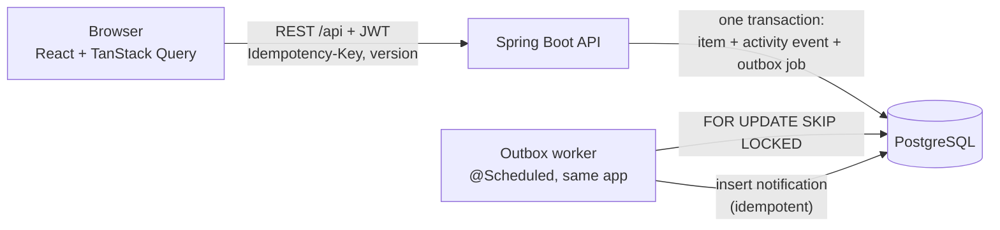
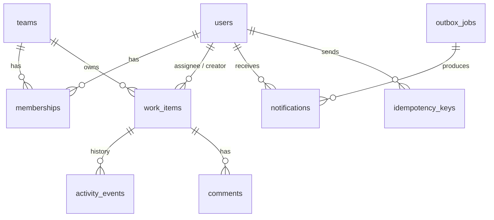
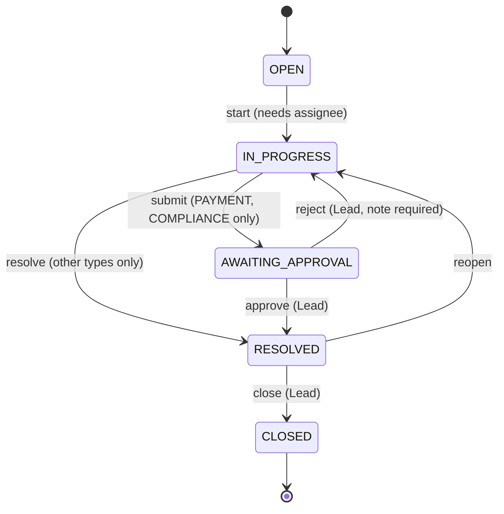

# Design

This is the design we build against. Product assumptions are in [ASSUMPTIONS.md](ASSUMPTIONS.md).

## 1. Architecture

* **One Spring Boot application** serves the REST API and runs the outbox worker.
  The worker uses row locks, so running several API instances is still safe.
* **PostgreSQL is the single source of truth.** Every state change, its activity
  event and its outbox job are written in **one transaction**, so history can never
  disagree with the item and a notification can never be lost.
* **Writes use JPA entities** (with `@Version`). **List and search reads use SQL via
  `NamedParameterJdbcTemplate`**, because keyset pagination and full-text search
  are clearer in SQL than in the Criteria API.

## 2. Data model

| Table | Purpose | Key constraints and indexes |
|-------|---------|-----------------------------|
| `users` | Seeded users; `is_admin` global flag; bcrypt password | unique `email` |
| `teams` | Teams | unique `name` |
| `memberships` | `(user, team, role)` with role `VIEWER/MEMBER/LEAD` | PK `(user_id, team_id)`; index `team_id` |
| `work_items` | The work item. `version` for optimistic locking. Generated `priority_rank` (sortable) and `search_vector` (full-text) | `(team_id, updated_at, id)`, `(assignee_id, status)`, partial index on unassigned open items, `(due_at)` partial on open items, GIN on `search_vector` |
| `activity_events` | **Append-only** history (`CREATED`, `STATUS_CHANGED`, `ASSIGNED`, `PRIORITY_CHANGED`, `UPDATED`, `COMMENTED`), old/new values in JSONB | `(item_id, created_at, id)` |
| `comments` | Discussion on an item | `(item_id, created_at)` |
| `idempotency_keys` | Stored responses of mutating requests | unique `(user_id, idem_key)` |
| `outbox_jobs` | Async work written in the same transaction as the change | partial index `(run_after)` where `status = 'PENDING'` |
| `notifications` | In-app notifications produced by the worker | unique `(source_job_id, user_id)` makes the handler idempotent |

## 3. Roles and permissions

Roles are **per team**. A global admin is treated as a Lead of every team.
Every endpoint calls one `AuthorizationService`; the UI only mirrors these rules.

| Action | Viewer | Member | Lead | Admin |
|--------|:------:|:------:|:----:|:-----:|
| View items of the team (list, detail, history, comments) | ✅ | ✅ | ✅ | ✅ |
| Create item in the team | ❌ | ✅ | ✅ | ✅ |
| Comment | ❌ | ✅ | ✅ | ✅ |
| Claim an unassigned item | ❌ | ✅ | ✅ | ✅ |
| Edit fields (title, description, type, priority, due date) | ❌ | assignee, or creator while unassigned | ✅ | ✅ |
| Assign / reassign / unassign someone else | ❌ | ❌ | ✅ | ✅ |
| Workflow transitions | ❌ | assignee only, non-approval steps | ✅ | ✅ |
| Approve / reject / close | ❌ | ❌ | ✅ | ✅ |

Items of a team the user does not belong to return **404**.

## 4. Workflow

| From | To | Who | Extra rule |
|------|----|-----|------------|
| OPEN | IN_PROGRESS | assignee or Lead | item must have an assignee |
| IN_PROGRESS | AWAITING_APPROVAL | assignee or Lead | type requires approval |
| IN_PROGRESS | RESOLVED | assignee or Lead | type does **not** require approval |
| AWAITING_APPROVAL | RESOLVED | Lead | approval |
| AWAITING_APPROVAL | IN_PROGRESS | Lead | rejection, `note` required |
| RESOLVED | IN_PROGRESS | assignee or Lead | reopen |
| RESOLVED | CLOSED | Lead | final |

Any other pair returns `422 INVALID_TRANSITION` (e.g. `OPEN → CLOSED`).

## 5. REST API

All endpoints are under `/api` and need `Authorization: Bearer <jwt>`, except login.
Errors use RFC 7807 `ProblemDetail` with an extra `code` field.

| Method | Path | Purpose | Notes |
|--------|------|---------|-------|
| POST | `/api/auth/login` | Email + password → JWT | |
| GET | `/api/me` | Current user and team roles | |
| GET | `/api/teams/{id}/members` | Members of a team (for assignment) | team members only |
| GET | `/api/items` | List / search | `view`, `teamId`, `status`, `priority`, `type`, `assigneeId`, `q`, `cursor`, `limit` |
| GET | `/api/items/summary` | Counts for dashboard views | |
| POST | `/api/items` | Create | `Idempotency-Key` |
| GET | `/api/items/{id}` | Detail | |
| PATCH | `/api/items/{id}` | Edit fields | body has `version`; stale → 409 + current item |
| POST | `/api/items/{id}/claim` | Take ownership | atomic; already taken → 409 |
| POST | `/api/items/{id}/assign` | Lead assigns `{assigneeId \| null, version}` | |
| POST | `/api/items/{id}/transition` | `{to, version, note?}` | workflow + role check |
| GET | `/api/items/{id}/activity` | History, cursor-paginated | |
| GET | `/api/items/{id}/comments` | Comments, cursor-paginated | |
| POST | `/api/items/{id}/comments` | Add comment | `Idempotency-Key` |
| GET | `/api/notifications` | My notifications | |
| POST | `/api/notifications/{id}/read` | Mark read | own notifications only |
| POST | `/api/notifications/read-all` | Mark all read | |

Dashboard `view` values:

* `mine`: assigned to me and not resolved/closed
* `unassigned_urgent`: unassigned, `HIGH`/`URGENT`, `OPEN`, in my teams
* `awaiting_my_approval`: `AWAITING_APPROVAL` in teams where I am Lead
* `overdue`: due date passed, not resolved/closed

### Status codes

| Code | When |
|------|------|
| 400 `VALIDATION_FAILED` | Bad input |
| 401 | Missing/invalid token or bad login |
| 403 `FORBIDDEN` | Member of the team but role does not allow the action |
| 404 `NOT_FOUND` | Item does not exist **or** belongs to a team the user is not in |
| 409 `ALREADY_CLAIMED` | Claim lost to another user |
| 409 `STALE_VERSION` | Client version outdated; response includes `current` item |
| 409 `IDEMPOTENCY_KEY_IN_USE` | Same key reused while the first request is still running |
| 422 `INVALID_TRANSITION` | Workflow does not allow this move |
| 422 `IDEMPOTENCY_KEY_REUSED` | Same key reused with a different request body |

## 6. Critical behaviours (beyond CRUD)

| # | Situation | Mechanism |
|---|-----------|-----------|
| 1 | Two users claim the same item | `UPDATE work_items SET assignee_id = :me, version = version + 1 WHERE id = :id AND assignee_id IS NULL`; 0 rows → 409 |
| 2 | Editing a stale version | Client sends `version`; compared to the current one, and JPA `@Version` guards the gap between read and write → 409 with the latest item |
| 3 | Repeated requests | `Idempotency-Key` row inserted **in the same transaction** as the action (`ON CONFLICT DO NOTHING`). A concurrent duplicate waits on the unique index, then replays the stored response. If the action fails, the key rolls back too, so retrying is allowed |
| 4 | Workflow rules | Transition table above, enforced in `WorkflowPolicy` on the server |
| 5 | Resource-level authorization | `AuthorizationService` checks role in the **item's** team; list queries are always filtered to the user's teams |
| 6 | Reliable async work | Transactional outbox. Worker claims one job with `FOR UPDATE SKIP LOCKED`, runs the handler and marks it done in **one transaction**. A crash rolls back, so the job is retried. Failures back off exponentially and become `FAILED` after `max_attempts`. Handlers are idempotent via unique `(source_job_id, user_id)` |
| 7 | Optimistic UI | TanStack Query applies the change at once, rolls back on 409/403/422 and shows the server's reason |

## 7. Pagination and search

* **Keyset (cursor) pagination** ordered by `(updated_at DESC, id DESC)`. The cursor
  encodes the last row's values, so pages stay correct while rows are inserted and
  cost is constant regardless of depth (no `OFFSET`).
* **Full-text search** on title (weight A) and description (weight B) through a
  generated `tsvector` column with a GIN index. Short queries also match the item
  id (`#123`).
* Every list query is limited to the user's teams and to at most 100 rows per page.

## 8. Asynchronous jobs

| Job | Written when | Effect |
|-----|-------------|--------|
| `NOTIFY_ASSIGNEE` | claim / assign | Notify the new assignee (unless they assigned themselves) |
| `NOTIFY_APPROVERS` | → `AWAITING_APPROVAL` | Notify every Lead of the team |
| `NOTIFY_DECISION` | approve / reject | Notify the assignee |
